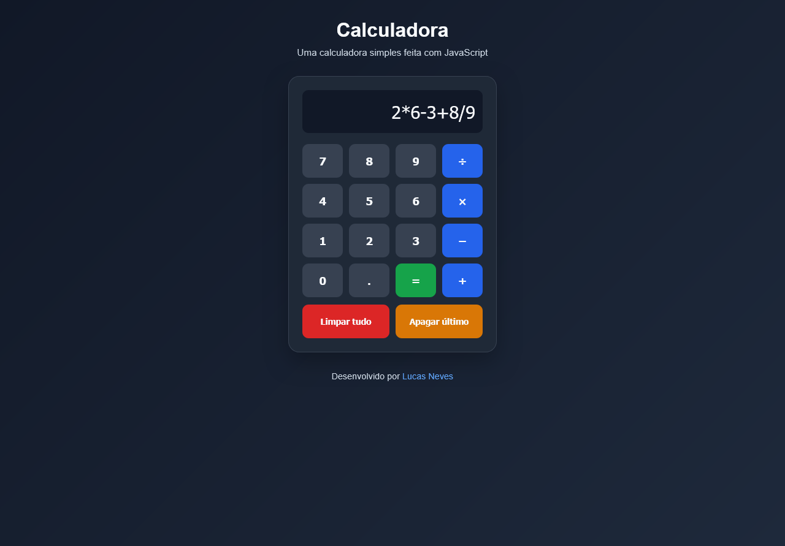

# JavaScript Calculator

A simple and responsive calculator built with HTML, CSS, and JavaScript. This project performs basic mathematical operations through an interactive interface with a clean, modern design.

## Features

- **Basic Operations:** Addition, subtraction, multiplication, and division.
- **Interactive Display:** Shows the current mathematical expression and its result.
- **Clear All:** Clears the entire expression.
- **Delete Last Character:** Removes the last character entered.
- **Error Handling:** Handles invalid expressions and mathematical errors.
- **Responsive Design:** Adapts to smaller screens and mobile devices.
- **Modern Interface:** Dark theme with distinct colors for operators and action buttons.

## Technologies Used

- HTML5
- CSS3
- JavaScript (Vanilla JS)

## Project Structure

```text
Calculadora/
├── index.html
├── css/
│   └── styles.css
├── js/
│   └── index.js
└── README.md
```

## Getting Started

### Prerequisites

You only need a modern web browser to run this project.

### Installation

1. Clone this repository:

   ```bash
   git clone https://github.com/Taunt-byte/Calculadora.git
   ```

2. Navigate to the project directory:

   ```bash
   cd Calculadora
   ```

3. Open `index.html` in your browser.

No additional dependencies or installations are required.

## How to Use

1. Click the number buttons to enter a mathematical expression.
2. Select an operator (`+`, `−`, `×`, or `÷`).
3. Click `=` to calculate the result.
4. Use **Delete Last** to remove the last character.
5. Use **Clear All** to reset the calculator.

## Learning Objectives

This project was developed to practice fundamental web development concepts, including:

- HTML structure and semantic elements.
- CSS Grid and responsive layouts.
- JavaScript functions and event handling.
- DOM manipulation.
- Event delegation using `addEventListener()`.
- Input validation and error handling.
- Separation of HTML, CSS, and JavaScript.

## Future Improvements

- Add physical keyboard support.
- Implement calculation history.
- Add percentage and parenthesis operations.
- Create a light and dark theme switcher.
- Implement automated tests.
- Replace dynamic expression evaluation with a dedicated mathematical parser.

## Screenshot



## Author

**Lucas Neves**

## License

This project is available for educational purposes. Add a license file if you intend to distribute it under specific terms.